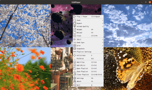
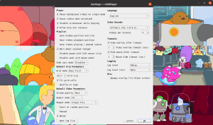
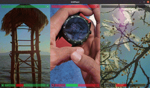

# GridPlayer mpv

Play as many videos as you like, side by side, in one window. The only limit is your hardware.

GridPlayer mpv is a fork of [GridPlayer](https://github.com/vzhd1701/gridplayer) by vzhd1701 that plays everything through
[mpv](https://mpv.io/) in place of VLC, with VLC removed entirely. It adds controls for keeping large grids smooth, and
a few other things listed [below](#whats-new-in-this-fork).

> **Status:** Windows 11, 64-bit, is the only platform this fork has been built and tested on. See
> [Other platforms](#other-platforms).

## Screenshots

These are from the original GridPlayer. The grid works the same way, but some of the controls and colors have changed.

[](resources/public/screenshot-001.png)
[](resources/public/screenshot-002.png)
[](resources/public/screenshot-003.png)
[](resources/public/screenshot-004.png)

## Features

- Plays any format mpv can play, with hardware or software decoding
- Plays streaming links through [Streamlink](https://streamlink.github.io/plugins.html) and
  [yt-dlp](https://github.com/yt-dlp/yt-dlp/blob/master/supportedsites.md)
- Grid layouts: automatic, fixed, free tiles and mosaic, with videos rearranged by drag and drop
- A whole list in one cell: m3u, pls and xspf playlists, folders, YouTube playlists, IPTV channels
- Cookie support for streams that need a login
- Skips sponsors and other marked parts of YouTube videos with [SponsorBlock](https://sponsor.ajay.app/)
- Per-video aspect ratio, crop, zoom, rotation, playback speed and audio and subtitle tracks
- Loops with frame precision, bookmarks and chapters
- Sync seeking, pausing, speed and zoom across videos
- Playlists remember the settings of each video

### What's new in this fork

- **mpv instead of VLC**, for both the Hardware and Software decoders
- **[Performance settings](#performance-settings):** video quality presets with an Auto mode, a graphics card picker and
  a hardware decoding option
- **Fast timeline dragging** that keeps showing frames as you drag, then lands on the exact spot when you let go
- **Volume above 100%**, up to a limit you set, with the amplified part of the bar marked in amber and the level shown
  as a number
- **True Dark**, a black color scheme alongside Light and the grey Dark. The on-video controls follow the dark themes
- **Duplicate** in the video's right-click menu, to play the same video again in the next cell

## Installation

No ready-made downloads are published yet, so for now you build it yourself. The build script fetches libmpv for you.

You need [uv](https://docs.astral.sh/uv/getting-started/installation/), Python 3.10 and
[git](https://git-scm.com/downloads). [Inno Setup](https://jrsoftware.org/isinfo.php) is optional, and only needed for
the installer.

```powershell
git clone --branch feat/mpv-prototype https://github.com/Brick2892/gridplayermpv.git
cd gridplayermpv
powershell -ExecutionPolicy Bypass -File scripts\windows\build_mpv.ps1
```

This puts the following in the `dist` folder. Add `-SkipInstaller` to the last command if you don't have Inno Setup.

| File | What it is |
| --- | --- |
| `GridPlayer-mpv-<version>-win64-portable.zip` | Unzip anywhere and run `GridPlayer.exe`. Settings stay in the `portable_data` folder beside it. |
| `GridPlayer-mpv-<version>-win64-install.exe` | Installs as "GridPlayer mpv", separately from the original GridPlayer. |

Neither is code-signed, so Windows SmartScreen may warn you the first time you run them.

### Running from source

Put `libmpv-2.dll` in `.local-tools\mpv` inside the project, or set the `GRIDPLAYER_MPV_DIR` environment variable to
the folder that has it. The DLL is in the `mpv-dev-x86_64` archive from
[mpv-winbuild-cmake](https://github.com/shinchiro/mpv-winbuild-cmake/releases).

```powershell
uv sync
uv run gridplayer
```

### Other platforms

The Linux and macOS code from the original project is still here, but this fork has not been built or tested on them,
and their packaging scripts still refer to VLC. For now, use the
[original GridPlayer](https://github.com/vzhd1701/gridplayer) on those systems.

## Performance settings

Go to **Settings -> Video Decoder -> Performance**.

| Setting | What it does |
| --- | --- |
| **Video quality** | How much of the graphics card goes on scaling the picture. See below. Hardware decoder only. |
| **Graphics card** | `Auto` leaves it to Windows. `High performance` and `Power saving` pick by the card's memory, or pick a card by name. Hardware decoder only. |
| **Hardware decoding** | `Auto` uses the graphics card with the Hardware decoder and the CPU with the Software one. `GPU, copied to memory` also speeds up the Software decoder. `Off` uses only the CPU. |
| **Fast seeking while dragging the timeline** | Jumps between keyframes during the drag, then goes to the exact spot when you let go. |

| Video quality | Scaling |
| --- | --- |
| **Auto** (default) | Goes by how large each video is on screen: Fast below about 0.6 megapixels, Balanced up to 1.5, High above that. A video that can't keep up drops a step on its own. |
| **Fast** | mpv's `fast` profile. Plays the most videos smoothly, with slightly softer scaling. |
| **Balanced** | Sharper upscaling for not much more work. |
| **High** | mpv's default scaling. |
| **Maximum** | mpv's `high-quality` profile. For a few videos on a strong card. |

**On a laptop with two graphics cards**, Windows may run video on the weaker one. If a large grid stutters, try setting
**Graphics card** to `High performance`. It uses more power, memory and CPU, and adds a few seconds to the first load.

If you have many high-resolution videos playing at once, the limit is often how many the card can decode, which no
scaling setting can change.

### Video Decoder settings

Also under **Settings -> Video Decoder**:

- **Decoder:** `Hardware` (the default) draws with the graphics card. `Software` uses only the CPU, and can put a heavy
  load on it with high-resolution video.
- **Videos per process:** how many videos share one player process. The default is 4.
- **mpv Options:** any [mpv option](https://mpv.io/manual/stable/#options), as `--name=value`. What you type here takes
  priority over the settings above. A typed `--profile=...` replaces the quality preset.

### Volume

The most the volume can go is set in **Settings -> Player -> Maximum volume**, from 100% to 300%. The default is 150%.

mpv's volume scale isn't linear, so it gets loud quickly: 150% is about 3.4 times the signal and 200% about 8 times.
Most audio will start to distort somewhere past 100%.

## Command line options

```shell
GridPlayer.exe [options] [FILE|URL ...]
```

Any arguments that are not options are treated as media files, folders, `.gpls` playlists, media lists (`.m3u`,
`.m3u8`, `.pls`, `.xspf`), or streaming URLs (`https://`, `rtsp://`, ...) to open on startup. A folder or a media list
plays in one cell, one file after another. Unrecognized options are rejected with an error. Use `--` to open
dash-prefixed filenames.

| Option | Description |
| --- | --- |
| `--user-data-dir PATH` | Store settings and log files in `PATH` instead of the default location. Relative paths are resolved against the current working directory. |
| `--version` | Show the application version and exit. |
| `--help` | Show the available options and exit. |

### Where settings are stored

By default, `settings.ini` and `gridplayer.log` are in `C:\Users\<USER>\AppData\Roaming\vzhd1701\GridPlayer`.
**Settings -> Open data folder** takes you there.

**This is the same folder the original GridPlayer uses**, so if you have both, they share settings. To keep them apart,
use the portable build or a custom folder.

The portable build uses its `portable_data` folder when that exists beside the executable. You can also choose any
folder:

```powershell
# with a command line option
.\GridPlayer.exe --user-data-dir .\my_data

# or with an environment variable
$env:GP_USER_DATA_DIR = "C:\path\to\my_data"
.\GridPlayer.exe
```

The command line option takes priority over the environment variable.

## Streaming cookies

Some links won't resolve without a login, especially YouTube with its *"Sign in to confirm you're not a bot"*.
GridPlayer can store cookies and pass them to both yt-dlp and Streamlink.

Go to **Settings -> Streaming -> Cookies** and import a `cookies.txt` file, or paste one from the clipboard.

### Exporting cookies from your browser

Export from a private window, and close it when you're done:

1. Open a private browsing window and log in to your site (YouTube in this example).
2. In the same tab, go to `https://www.youtube.com/robots.txt` (any static page on the site).
3. Export or copy cookies for the site with a browser extension
   ([Firefox](https://addons.mozilla.org/en-US/firefox/addon/cookies-txt/),
   [Chrome](https://chrome.google.com/webstore/detail/get-cookiestxt-locally/cclelndahbckbenkjhflpdbgdldlbecc)).
4. Close the window **without logging out**. Logging out kills the session you just exported.
5. Import the `cookies.txt` file into GridPlayer, or paste it.

YouTube rotates cookies on open tabs. If you export from your normal session, the export will go stale within hours. A
private window you never reopen has nothing left to rotate them. For the same reason, don't use one export in two places
at once.

More detail is in the [yt-dlp FAQ](https://github.com/yt-dlp/yt-dlp/wiki/FAQ#how-do-i-pass-cookies-to-yt-dlp).

### Where cookies are stored

`cookies.txt` in the [settings folder](#where-settings-are-stored), in the standard Netscape format.

The file isn't encrypted, so treat it like a password. Import only the domains you need, and clear the store when you're
done with them.

## Network settings

A proxy, an address family and a user agent shared by everything GridPlayer fetches with: yt-dlp, Streamlink and the
player itself.

Go to **Settings -> Streaming -> Network**.

| Setting | What it does |
| --- | --- |
| **Proxy** | `System` follows the machine's own proxy settings. `None` connects directly, ignoring them. `Custom` takes an address of your own. |
| **Proxy address** | `http://host:port`, or `socks5h://host:port` to resolve names at the proxy rather than locally. |
| **Request timeout** | How long to wait on a request before giving up. Applies while a link is being resolved, not while it is playing. `Auto` leaves each tool on its own default, which is 20 seconds for both. |
| **User agent** | How the player identifies itself. `Auto` leaves each tool on its own. A link that came with a user agent of its own keeps it. |
| **Force IPv4** | Skip IPv6. Fixes a connection that stalls on IPv6 that is offered but does not work, and sites that turn away your IPv6 address. |
| **Verify TLS certificates** | Turn off only for a proxy that signs traffic with its own certificate. |

### What these apply to

**http and https links only**, apart from the user agent.

When a proxy, Force IPv4 or a change to certificate checks is set, links stop being handed straight to the player.
GridPlayer fetches them itself and serves them to the player from `127.0.0.1`.

Links of other kinds, such as `rtsp` and `rtmp`, are opened by the player itself and go out directly. Only the user
agent reaches those. If you need those proxied too, proxy the whole machine.

## JavaScript runtime

YouTube scrambles its stream addresses with a script that has to be run to undo. GridPlayer doesn't ship an engine to
run it with, so if YouTube links stop playing, install one of these and restart:

| Engine | Size | Speed | |
| --- | --- | --- | --- |
| **[Deno](https://docs.deno.com/runtime/getting_started/installation/)** | ~110 MB | fastest | Recommended. Sandboxed by default. |
| **[Node](https://nodejs.org/)** | ~80 MB | fastest | Version 22 or newer. Just as good, and you may have it already. |
| **[QuickJS](https://github.com/quickjs-ng/quickjs/releases)** (`qjs`) | ~2 MB | ~7x slower | Tiny, but adds a few seconds to every YouTube link. |
| **[Bun](https://bun.sh/)** | ~90 MB | fast | Version 1.2.11 or newer. |

Any one of them is enough, and GridPlayer uses the best one it finds. It looks in these places, in order:

1. The folder named in **Settings -> Streaming -> Link Resolution -> JavaScript runtime**, if you set one.
2. The [settings folder](#where-settings-are-stored). Drop the binary in next to `settings.ini`.
3. The usual install locations: your `PATH`, `~/.deno/bin` and `~/.bun/bin`.

**Settings -> Streaming -> Link Resolution -> Test a YouTube link** names the one that will actually be used and where
it is.

Not every link needs one. YouTube often hands out addresses that need no unscrambling at all, and nothing else
GridPlayer plays uses this. It's worth installing when YouTube specifically starts failing.

## Known limitations

- Only tested on 64-bit Windows 11. See [Other platforms](#other-platforms).
- The deinterlace **mode** setting has no effect, because mpv picks the deinterlacer itself. Turning deinterlacing on
  and off works.
- The Dolby Surround and headphone audio modes run, but haven't been checked by ear.
- The About dialog and some project links still name the original project.
- Text added by this fork is in English in every language until it is translated.

## Development

```powershell
uv sync
uv run pytest
```

A plain `pytest` run skips the tests that need libmpv and a desktop. To run those against real playback, on Windows:

```powershell
uv run pytest -m mpv
```

They open video windows for a few minutes. See [CONTRIBUTING.md](CONTRIBUTING.md) for the project's conventions, which
come from the original GridPlayer.

## Getting help

To report a bug in this fork or ask for a feature, [open an issue](https://github.com/Brick2892/gridplayermpv/issues).
Please don't report bugs in this fork to the original project.

## Credits

GridPlayer was created by [vzhd1701](https://github.com/vzhd1701), and nearly all of the app outside the video playback
is their work. This fork builds on it under the terms of the GPL.

Built with:

- **Python** by [Python Software Foundation](https://www.python.org/), licensed under the *Python Software Foundation
  License*
- **Qt** by [Qt Project](https://www.qt.io/), licensed under *GPL 2.0, GPL 3.0, and LGPL 3.0*
- **mpv** by the [mpv contributors](https://mpv.io/), licensed under *GPL 2.0 or later*
- **libmpv Windows builds** by [shinchiro](https://github.com/shinchiro/mpv-winbuild-cmake)

### Python packages

- **PyQt** by [Riverbank Computing](https://riverbankcomputing.com/), licensed under *Riverbank Commercial License and
  GPL v3*
- **python-mpv** by [jaseg](https://github.com/jaseg/python-mpv), licensed under *GPL 2.0 and LGPL 2.1*
- **pydantic** by [Samuel Colvin](https://github.com/samuelcolvin/pydantic), licensed under *MIT License*
- **streamlink** by [Christopher Rosell, Streamlink Team](https://github.com/streamlink/streamlink), licensed under
  *BSD-2-Clause License*
- **yt-dlp** by [Contributors](https://github.com/yt-dlp/yt-dlp), licensed under *Unlicense License*

### Graphics

- **Hack Font** by [Source Foundry](http://sourcefoundry.org/hack/), licensed under *MIT License*
- **Basic Icons** by [Icongeek26](https://www.flaticon.com/authors/icongeek26), licensed under *Flaticon License*
- **Suru Icons** by [Sam Hewitt](https://snwh.org/), licensed under *Creative Commons Attribution-Share Alike 4.0*
- **Clean App Download Buttons** by [Tony Thomas](https://medialoot.com/item/clean-app-download-buttons/), licensed
  under *MediaLoot License*
- **Flag Icons** by [Panayiotis Lipiridis](https://github.com/lipis/flag-icons), licensed under *MIT License*
- **Lucide Icons** by [Lucide Contributors](https://lucide.dev/), licensed under *ISC License*

### Data

- **SponsorBlock** by [Ajay Ramachandran and contributors](https://sponsor.ajay.app/), licensed under *CC BY-NC-SA 4.0*

### Translations

The app's translations come from the original project's translators on
[Crowdin](https://crowdin.com/project/gridplayer).

<details>
<summary>Translators</summary>

<!-- CROWDIN-CONTRIBUTORS-START -->

<table>
  <tbody>
    <tr>
      <td align="center" valign="top">
        <a href="https://crowdin.com/profile/VenusGirl">
          <br />
          <sub><b>VenusGirl</b></sub></a>
        <br />
        <sub><b>886 words</b></sub>
        <br /><sub><b><code title="Korean">ko</code></b></sub>
      </td>
      <td align="center" valign="top">
        <a href="https://crowdin.com/profile/LOUIS_Sylvain">
          <br />
          <sub><b>Sylvain LOUIS</b></sub>
          <br />
          <sub><b>(LOUIS_Sylvain)</b></sub></a>
        <br />
        <sub><b>886 words</b></sub>
        <br /><sub><b><code title="French">fr</code></b></sub>
      </td>
      <td align="center" valign="top">
        <a href="https://crowdin.com/profile/Gabriel-BS1">
          <br />
          <sub><b>GBS ~ TECH</b></sub>
          <br />
          <sub><b>(Gabriel-BS1)</b></sub></a>
        <br />
        <sub><b>886 words</b></sub>
        <br /><sub><b><code title="Portuguese, Brazilian">pt-BR</code></b></sub>
      </td>
      <td align="center" valign="top">
        <a href="https://crowdin.com/profile/Granberg">
          <br />
          <sub><b>Göran</b></sub>
          <br />
          <sub><b>(Granberg)</b></sub></a>
        <br />
        <sub><b>875 words</b></sub>
        <br /><sub><b><code title="Swedish">sv-SE</code></b></sub>
      </td>
      <td align="center" valign="top">
        <a href="https://crowdin.com/profile/royhendum">
          <br />
          <sub><b>Roy Hendum</b></sub>
          <br />
          <sub><b>(royhendum)</b></sub></a>
        <br />
        <sub><b>875 words</b></sub>
        <br /><sub><b><code title="Norwegian">no</code></b></sub>
      </td>
      <td align="center" valign="top">
        <a href="https://crowdin.com/profile/zxas">
          <br />
          <sub><b>z Z</b></sub>
          <br />
          <sub><b>(zxas)</b></sub></a>
        <br />
        <sub><b>851 words</b></sub>
        <br /><sub><b><code title="Chinese Traditional">zh-TW</code></b></sub>
      </td>
    </tr>
    <tr>
      <td align="center" valign="top">
        <a href="https://crowdin.com/profile/davidev1">
          <br />
          <sub><b>Davide V.</b></sub>
          <br />
          <sub><b>(davidev1)</b></sub></a>
        <br />
        <sub><b>752 words</b></sub>
        <br /><sub><b><code title="Italian">it</code></b></sub>
      </td>
      <td align="center" valign="top">
        <a href="https://crowdin.com/profile/Vistaus">
          <br />
          <sub><b>Heimen Stoffels</b></sub>
          <br />
          <sub><b>(Vistaus)</b></sub></a>
        <br />
        <sub><b>751 words</b></sub>
        <br /><sub><b><code title="Dutch">nl</code></b></sub>
      </td>
      <td align="center" valign="top">
        <a href="https://crowdin.com/profile/japanese.john.doe.774">
          <br />
          <sub><b>七篠孝志</b></sub>
          <br />
          <sub><b>(japanese.john.doe.774)</b></sub></a>
        <br />
        <sub><b>751 words</b></sub>
        <br /><sub><b><code title="Japanese">ja</code></b></sub>
      </td>
      <td align="center" valign="top">
        <a href="https://crowdin.com/profile/DominikPott">
          <br />
          <sub><b>DominikPott</b></sub></a>
        <br />
        <sub><b>751 words</b></sub>
        <br /><sub><b><code title="German">de</code></b></sub>
      </td>
      <td align="center" valign="top">
        <a href="https://crowdin.com/profile/Azoaz6001">
          <br />
          <sub><b>Azoaz6001</b></sub></a>
        <br />
        <sub><b>751 words</b></sub>
        <br /><sub><b><code title="Arabic">ar</code></b></sub>
      </td>
      <td align="center" valign="top">
        <a href="https://crowdin.com/profile/wyg945">
          <br />
          <sub><b>Yagang Wang</b></sub>
          <br />
          <sub><b>(wyg945)</b></sub></a>
        <br />
        <sub><b>751 words</b></sub>
        <br /><sub><b><code title="Chinese Simplified">zh-CN</code></b></sub>
      </td>
    </tr>
    <tr>
      <td align="center" valign="top">
        <a href="https://crowdin.com/profile/Golbinex">
          <br />
          <sub><b>Kryštof Baksa</b></sub>
          <br />
          <sub><b>(Golbinex)</b></sub></a>
        <br />
        <sub><b>674 words</b></sub>
        <br /><sub><b><code title="Czech">cs</code></b></sub>
      </td>
      <td align="center" valign="top">
        <a href="https://crowdin.com/profile/IngrownMink4">
          <br />
          <sub><b>Sergio Varela</b></sub>
          <br />
          <sub><b>(IngrownMink4)</b></sub></a>
        <br />
        <sub><b>652 words</b></sub>
        <br /><sub><b><code title="Spanish">es-ES</code></b></sub>
      </td>
      <td align="center" valign="top">
        <a href="https://crowdin.com/profile/fifi132">
          <br />
          <sub><b>rafal132</b></sub>
          <br />
          <sub><b>(fifi132)</b></sub></a>
        <br />
        <sub><b>598 words</b></sub>
        <br /><sub><b><code title="Polish">pl</code></b></sub>
      </td>
      <td align="center" valign="top">
        <a href="https://crowdin.com/profile/a2942">
          <br />
          <sub><b>a2942</b></sub></a>
        <br />
        <sub><b>496 words</b></sub>
        <br /><sub><b><code title="Chinese Simplified">zh-CN</code></b></sub>
      </td>
      <td align="center" valign="top">
        <a href="https://crowdin.com/profile/LiberiFatali">
          <br />
          <sub><b>LiberiFatali</b></sub></a>
        <br />
        <sub><b>456 words</b></sub>
        <br /><sub><b><code title="Vietnamese">vi</code></b></sub>
      </td>
      <td align="center" valign="top">
        <a href="https://crowdin.com/profile/samu112">
          <br />
          <sub><b>samu112</b></sub></a>
        <br />
        <sub><b>438 words</b></sub>
        <br /><sub><b><code title="Hungarian">hu</code></b></sub>
      </td>
    </tr>
    <tr>
      <td align="center" valign="top">
        <a href="https://crowdin.com/profile/asolis2020">
          <br />
          <sub><b>asolis2020</b></sub></a>
        <br />
        <sub><b>266 words</b></sub>
        <br /><sub><b><code title="Spanish">es-ES</code></b></sub>
      </td>
      <td align="center" valign="top">
        <a href="https://crowdin.com/profile/SolarCTP">
          <br />
          <sub><b>SolarCTP</b></sub></a>
        <br />
        <sub><b>164 words</b></sub>
        <br /><sub><b><code title="Italian">it</code></b></sub>
      </td>
      <td align="center" valign="top">
        <a href="https://crowdin.com/profile/PrinceNorris">
          <br />
          <sub><b>Sebastian Jasiński</b></sub>
          <br />
          <sub><b>(PrinceNorris)</b></sub></a>
        <br />
        <sub><b>163 words</b></sub>
        <br /><sub><b><code title="Polish">pl</code></b></sub>
      </td>
      <td align="center" valign="top">
        <a href="https://crowdin.com/profile/reiss404">
          <br />
          <sub><b>Manuel</b></sub>
          <br />
          <sub><b>(reiss404)</b></sub></a>
        <br />
        <sub><b>133 words</b></sub>
        <br /><sub><b><code title="German">de</code></b></sub>
      </td>
      <td align="center" valign="top">
        <a href="https://crowdin.com/profile/aportuguesecoder">
          <br />
          <sub><b>Armando Gomes</b></sub>
          <br />
          <sub><b>(aportuguesecoder)</b></sub></a>
        <br />
        <sub><b>121 words</b></sub>
        <br /><sub><b><code title="Portuguese">pt-PT</code></b></sub>
      </td>
      <td align="center" valign="top">
        <a href="https://crowdin.com/profile/Akronos">
          <br />
          <sub><b>Akronos</b></sub></a>
        <br />
        <sub><b>112 words</b></sub>
        <br /><sub><b><code title="Czech">cs</code></b></sub>
      </td>
    </tr>
    <tr>
      <td align="center" valign="top">
        <a href="https://crowdin.com/profile/WackyFox">
          <br />
          <sub><b>Владимир Ларин</b></sub>
          <br />
          <sub><b>(WackyFox)</b></sub></a>
        <br />
        <sub><b>108 words</b></sub>
        <br /><sub><b><code title="Hebrew">he</code></b></sub>
      </td>
    </tr>
  </tbody>
</table>
<!-- CROWDIN-CONTRIBUTORS-END -->

</details>

## License

This software is licensed under the terms of the GNU General Public License version 3 (GPLv3). The full text is in the
[LICENSE](LICENSE) file and [online](https://www.gnu.org/licenses/gpl-3.0.html).
